 

 

## Sobre mim

Olá! Eu sou o **Eduardo**, apaixonado por tecnologia e programação.

Sou estudante do **Técnico em Programação de Jogos Digitais** e estou construindo minha base em **C#** e **Unity**. Meu objetivo é me tornar **Desenvolvedor Front-end**, criando interfaces modernas e fáceis de usar.

Estou sempre buscando aprender novas tecnologias e melhorar minhas habilidades um pouco a cada dia.

 

## Foco atual

| | |
|---|---|
| **Estudando** | C# e desenvolvimento com Unity |
| **Próximo passo** | HTML, CSS e JavaScript |
| **Objetivo** | Carreira como Desenvolvedor Front-end |
| **Em andamento** | Primeiros projetos e portfólio |

 

## Tecnologias

**Linguagem**

**Ferramentas**

**Próximos estudos**

 

## Progresso de estudos

 

## Estatísticas do GitHub

 

## Atividade

 

## Projetos

Estou no início da jornada e meus primeiros projetos estão sendo preparados. Em breve eles aparecem aqui.

**O que pretendo desenvolver:**

- Jogos com C# e Unity
- Sites e interfaces modernas
- Projetos de Front-end
- Experimentos para praticar programação

 

## Objetivos

- [x] Começar minha jornada na programação
- [x] Aprender os fundamentos de C#
- [ ] Aprofundar meus conhecimentos em Unity
- [ ] Aprender HTML
- [ ] Aprender CSS
- [ ] Aprender JavaScript
- [ ] Criar meus primeiros projetos Front-end
- [ ] Construir meu portfólio
- [ ] Me tornar Desenvolvedor Front-end

 

