<div align="center">




<br/>

<a href="https://github.com/EduardoWandermurem25"></a>
<a href="https://www.linkedin.com/in/eduardo-rodrigues-wandemurem-055b60372"></a>
<a href="https://www.instagram.com/eduardowandermurem25/"></a>

</div>

<br/>

## 🗡️ Ficha do personagem

| | |
|---|---|
| 🧑‍💻 **Nome** | Eduardo |
| 🎓 **Classe** | Estudante de Programação de Jogos Digitais |
| ⭐ **Nível** | Aprendiz em constante evolução |
| 🛠️ **Equipamentos** | C# · Unity · VS Code · Git · GitHub |
| 🧭 **Missão principal** | Tornar-me Desenvolvedor Front-end |
| 🎒 **No inventário** | Curiosidade, café e muitos bugs para resolver |

> *"Cada linha de código é um novo nível desbloqueado."*

Sou apaixonado por tecnologia, programação e pelo universo dos games. Meu perfil é inspirado no clima de **Hora de Aventura**: bom humor, criatividade e vontade de explorar o desconhecido, uma linha de código por vez.

<br/>

## 📈 Barras de XP

> Valores só para brincar e mostrar a evolução. Ajuste conforme você for subindo de nível.

```text
C#          ████████░░░░  Em evolução
Unity       █████░░░░░░░  Explorando
HTML        ██░░░░░░░░░░  Próxima fase
CSS         █░░░░░░░░░░░  Próxima fase
JavaScript  █░░░░░░░░░░░  Próxima fase
```

<br/>

## 💻 Arsenal

**Linguagem**


**Ferramentas**


**Desbloqueando em breve**


<br/>

## 📊 Estatísticas do jogador

<div align="center">


</div>

<br/>

## 🏆 Troféus

<div align="center">


</div>

<br/>

## 📉 Gráfico de atividade

<div align="center">


</div>

<br/>

## 🎮 Projetos

Estou no início da jornada e meus primeiros projetos estão sendo forjados. Em breve eles aparecem aqui!

**Próximas quests:**

- 🎮 Jogos com C# e Unity
- 🌐 Sites e interfaces modernas
- 💻 Projetos de Front-end
- ⚙️ Experimentos para praticar programação

<div align="center">

<a href="https://github.com/EduardoWandermurem25?tab=repositories"></a>

</div>

<br/>

## 🐍 Trilha de contribuições

<div align="center">


</div>

<br/>

## 🗺️ Mapa de missões

- [x] Começar minha jornada na programação
- [x] Aprender os fundamentos de C#
- [ ] Aprofundar meus conhecimentos em Unity
- [ ] Aprender HTML
- [ ] Aprender CSS
- [ ] Aprender JavaScript
- [ ] Criar meus primeiros projetos Front-end
- [ ] Construir meu portfólio
- [ ] Me tornar Desenvolvedor Front-end

<br/>

<div align="center">


</div>
